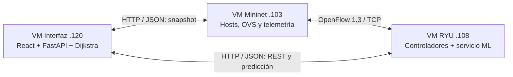
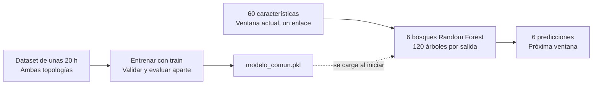
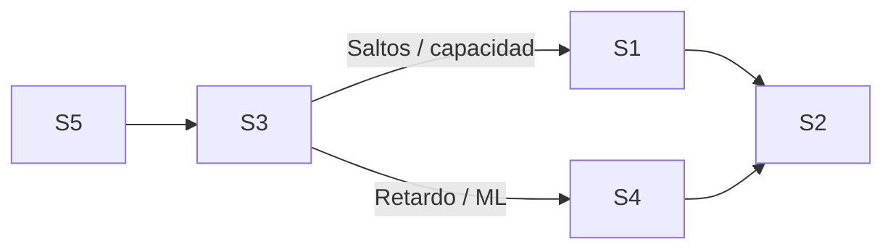
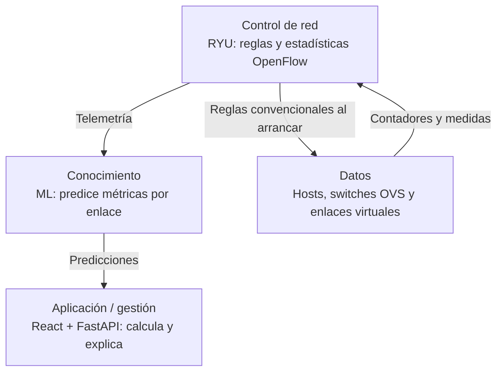
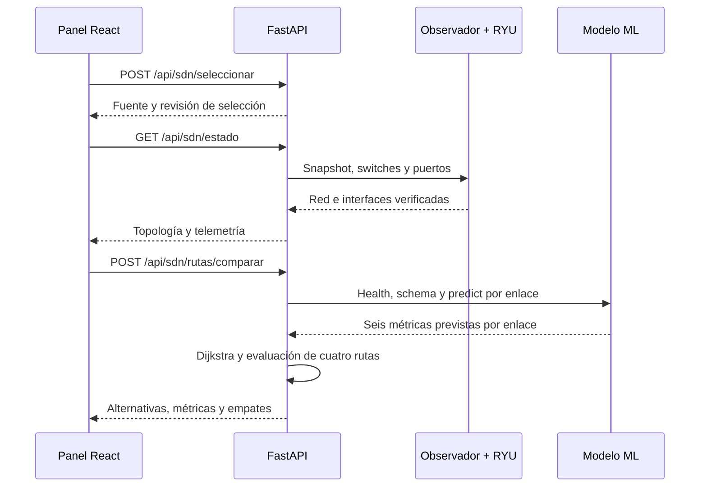

# Guía sencilla del proyecto SDN/KDN

## 1. Guía del proyecto SDN/KDN

Modelo ML, red y aplicación explicados con diagramas. Versión documentada: 9 de noviembre de 2026.

El laboratorio observa dos topologías virtuales, predice cómo podrían comportarse sus enlaces y compara cuatro formas de elegir un camino entre dos nodos. Su objetivo actual es **apoyar y explicar decisiones de enrutamiento**.

| Componente | Qué hace |
| --- | --- |
| Mininet | Emula hosts, switches y enlaces. Genera el tráfico controlado y recoge mediciones. |
| RYU + ML | RYU mantiene el canal OpenFlow. Un servicio separado carga el modelo entrenado y responde predicciones. |
| Interfaz | FastAPI valida los datos y calcula las rutas. React dibuja el mapa, las métricas y la comparación. |

### Tres ideas para leer toda la guía

**Medir:** observar lo que ocurrió en una ventana. **Predecir:** estimar las métricas de la próxima. **Calcular una ruta:** buscar un camino de menor costo usando un criterio definido.

> **Punto clave:** el modelo devuelve métricas por enlace. Dijkstra utiliza esas métricas para calcular una propuesta de ruta. El botón de comparación no instala esa propuesta en los switches.

Las redes comparten un modelo, pero sus sesiones y controladores se verifican por separado. El tráfico experimental circula dentro de Mininet; las peticiones HTTP sirven para gestión y consulta.

---

## 2. Cómo funciona el modelo ML

Primero aprendió con datos históricos; en la aplicación se reutiliza para hacer inferencia.

El código de entrenamiento utiliza **MultiOutputRegressor con RandomForestRegressor**: seis bosques independientes, uno por salida. Cada bosque contiene 120 árboles. Los árboles realizan decisiones a partir de características del enlace y el bosque promedia sus estimaciones. [1]

### Qué entra y qué sale

| Entrada: 60 características | Salida: 6 números previstos |
| --- | --- |
| 12 generales: capacidad, retardo y colas configurados, carga ofrecida, CPU y memoria. 24 del extremo u + 24 del extremo v: bytes, paquetes, errores, drops, carga y colas. | Throughput RX, delay y loss de u → v.  Throughput RX, delay y loss de v → u. |

**Throughput RX** es tráfico recibido, en Mbps; **delay** es retardo, en ms; **loss** es la proporción de pérdida, de 0 a 1. Las características describen una ventana medida, del orden de 20 segundos más el tiempo de medición. El objetivo corresponde a una ventana posterior. Las dos direcciones se conservan: ida y vuelta pueden comportarse distinto.

### Cómo se preparó y cómo se usa

El dataset documenta unas **20 horas totales entre ambas topologías**. Train ajusta los bosques; validación y test comprueban su comportamiento. El código impide mezclar un mismo run, escenario o semilla entre particiones y exige que las entradas precedan a sus etiquetas futuras.

En ejecución, el servicio carga el archivo .pkl y responde con predict(); pulsar un botón no vuelve a entrenarlo. Se exige la sesión correcta, las 60 entradas completas y una antigüedad máxima de 120 segundos. Un modelo cargado no garantiza que exista una predicción reciente de cada enlace.

---

## 3. Cómo se eligen y comparan rutas

Las cuatro alternativas usan el mismo grafo y la misma ventana de predicción.

| Criterio | Costo que minimiza Dijkstra |
| --- | --- |
| Menos saltos | Un punto por enlace recorrido. |
| Menor retardo configurado | Suma de los retardos configurados en Mininet. |
| Inversa de capacidad | Suma de 1 / capacidad nominal por enlace. |
| Inteligente ML | Suma de costos QoS direccionales basados en predicciones. |

> **Costo ML:** combina componentes por enlace en escala 0 a 1: delay previsto, loss previsto y penalización por capacidad baja. Pesos iniciales: 0,50; 0,35; 0,15. La carga RX tiene peso 0: poco tráfico recibido también puede significar poca demanda. Los pesos se pueden ajustar.

| GEANT2: ejemplo registrado | Delay previsto | Capacidad mínima nominal |
| --- | --- | --- |
| Saltos / capacidad | 73,17 ms | 3 Mbps |
| Retardo / ML | 27,50 ms | 1,5 Mbps |

Aquí ML y menor retardo coinciden: reducen el delay previsto, a cambio de una capacidad nominal mínima menor. No hay un ganador universal. El ejemplo es histórico; una nueva ventana puede producir otros resultados.

**Comparación justa:** el QoS común usa la misma fórmula para los cuatro caminos. El delay previsto se suma; el loss compuesto se estima como 1 - producto(1 - loss del enlace). La pérdida de las sondas incluye rechazos locales de envío. Se muestra la capacidad mínima nominal; no se suman los throughputs ni se presenta una medición extremo a extremo.

---

## 4. Planos de red y protocolos

Los planos organizan funciones. Las capas de protocolos explican cómo viaja la información.

El **plano de control** es lo que aquí corresponde a controlar la red. La **capa de red**, en cambio, es la capa IP: son conceptos distintos. El plano de conocimiento aporta estimaciones al análisis; el cierre automático del ciclo ML → reglas aún no está implementado.

| Capa o mecanismo | Uso concreto en el proyecto |
| --- | --- |
| Aplicación | HTTP con JSON: panel, FastAPI, observadores y ML. OpenFlow intercambia reglas y estadísticas; el REST de RYU permite consultarlas o gestionarlas. |
| Transporte | TCP para HTTP y para el canal OpenFlow. UDP hacia puerto 5001 para el tráfico controlado entre hosts emulados. |
| Red | IPv4. Red de gestión 192.168.56.x entre VMs; direcciones 10.0.0.x en los hosts emulados. |
| Enlace | Ethernet, MAC y pares veth; ARP estático en los hosts. Sondas de delay/loss: EtherType 0x88B5 y sockets AF_PACKET. |
| Virtualización | Mininet usa namespaces Linux; OVS conmuta tramas. tc/netem configura capacidad, retardo y colas de los enlaces virtuales. |

> **Tráfico real de esta emulación:** al arrancar, el lanzador calcula caminos por retardo configurado y pide a RYU reglas por MAC de destino. RYU las comunica a OVS con OpenFlow 1.3. La referencia por capacidad que aparece en la tabla es un cálculo de comparación; no acredita qué camino está usando el tráfico.

---

## 5. Qué ocurre al pulsar un botón

El navegador solicita información; FastAPI coordina las consultas y devuelve resultados.

Las flechas muestran peticiones de gestión. FastAPI fija un snapshot, valida las entradas y evalúa cuatro alternativas. Consulta salud y esquema una vez; después obtiene o reutiliza predicciones por enlace, con ambas direcciones. [2]

| Petición del panel a FastAPI | Para qué sirve |
| --- | --- |
| GET /api/sdn/estado | Topología, sesión, enlaces, estado de RYU y telemetría. El panel consulta de nuevo unos 5 s después de cada respuesta. |
| POST /api/sdn/seleccionar | Elegir NSFNET, GEANT2 o Auto, sin escribir el puerto del observador. |
| POST /api/sdn/rutas | Calcular una ruta convencional con el criterio elegido. |
| POST /api/sdn/rutas/comparar | Devolver las cuatro alternativas, costos comunes, diferencias y empates. |
| GET /api/sdn/ml/estado POST /api/sdn/ml/predecir | Comprobar el modelo o solicitar la predicción de un enlace. |

La comparación envía origen, destino e identificadores de instancia, grafo y selección; puede incluir pesos QoS. El servidor construye el grafo desde la fuente verificada. Si cambian la sesión o el grafo durante el cálculo, rechaza el resultado y pide actualizar.

---

## 6. Arquitectura práctica y lectura del panel

Dónde está cada función y cómo interpretar lo que se muestra.

| Bloque de código | Responsabilidad |
| --- | --- |
| SelectorRoot + PanelSdn + ComparacionRutas | Selección, consultas, mapa y presentación de las cuatro rutas. |
| fuentes_sdn + sdn_vivo_runtime_v1 | Resolver fuentes y comprobar DPID, puertos e identidad de la sesión. |
| sdn_comparacion + comparacion_rutas | Validar la solicitud, fijar la ventana, calcular costos, ejecutar Dijkstra y comparar métricas. |
| sdn_predicciones_enlace_v1 + servidor.py | Validar entradas y salidas, consultar inferencia y reutilizar resultados válidos. |

| Servicio | GEANT2 | NSFNET |
| --- | --- | --- |
| Observador en Mininet .103 | 8768 | 8769 |
| OpenFlow en RYU .108 | 16653 | 16654 |
| REST de RYU .108 | 18080 | 18081 |

Servicios compartidos: ML en RYU:8010; FastAPI en la VM de interfaz:8002; página web en esa VM:5181. Estos puertos pertenecen a la configuración del laboratorio; no son todos puertos estándar de sus protocolos.

### Cómo leer los resultados

**Red verificada** significa identidad y puertos compatibles. **Telemetría reciente** significa una ventana utilizable. **Modelo disponible** significa que el servicio responde. Se necesitan las tres condiciones para una comparación ML válida.

Las etiquetas «Mejor» y «Empate» se aplican a cada indicador. Las ventajas y desventajas textuales se comparan con la referencia por capacidad. Al caducar las entradas o cambiar de sesión, la aplicación invalida los resultados. Si no hay ML válido, quedan las tres rutas convencionales y sus valores nominales.

### Fuentes y alcance

Guía basada en el código desplegado y los reportes originales del modelo: scikit-learn 0.24.2, seis salidas y 120 árboles por bosque. Se revisó sin modificar datasets ni modelos. Los ejemplos de rutas proceden de la validación registrada del 9 de noviembre de 2026.

[1] [scikit-learn: RandomForestRegressor](https://scikit-learn.org/stable/modules/generated/sklearn.ensemble.RandomForestRegressor.html) y [MultiOutputRegressor](https://scikit-learn.org/stable/modules/generated/sklearn.multioutput.MultiOutputRegressor.html).
[2] [RYU: API REST de OpenFlow](https://ryu.readthedocs.io/en/latest/app/ofctl_rest.html).
[3] [Mininet: emulación y namespaces](https://mininet.org/overview/); [Open vSwitch y OpenFlow](https://docs.openvswitch.org/en/latest/faq/openflow/).
Código y evidencias: [github.com/Sergio777gg/sdn-kdn-rutas-ml](https://github.com/Sergio777gg/sdn-kdn-rutas-ml).
